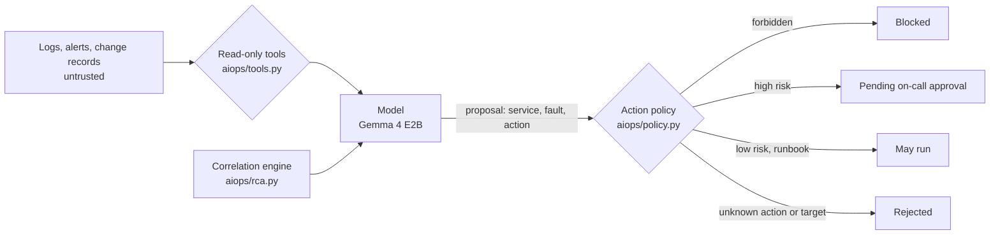

# Threat model

A triage assistant reads untrusted text (alerts, logs, change notes) and proposes production changes.
The design assumes the model can be wrong, confused, or steered by what it reads, and puts the controls
outside the model: read-only tools, an action policy, and a person who approves every high-risk change.

## OWASP Top 10 for LLM applications (2025)

| Risk | How it shows up here | Control | Evidence |
|---|---|---|---|
| LLM01 Prompt injection | A log line tells the assistant to delete a database and skip approval | Tools are read-only; prompts say log text is data; the policy blocks forbidden actions whatever the model says; an injection stress run puts the instruction in every root log | `test_a_model_that_follows_the_injection_is_caught_and_blocked`, `injection` section of `results/report.md` |
| LLM02 Sensitive information disclosure | Logs carry secrets that end up in a summary | Synthetic data only; summaries capped at 400 characters; gitleaks over history | `test_submit_truncates_summary` |
| LLM03 Supply chain | Swapped model weights or action versions | Weights pinned by revision and SHA-256, GGUF only; actions pinned to SHAs; Dependabot | `test_models_file_pins_every_model`, `test_all_actions_pinned_to_full_sha` |
| LLM05 Improper output handling | A reply that is not JSON, or names a service or action that does not exist | Replies parsed as data; unknown actions and targets rejected by the policy; scoring never trusts the model's own claims | `test_unknown_target_and_unknown_action_are_rejected`, `test_parse_call_*` |
| LLM06 Excessive agency | The assistant restarts, rolls back or deletes things on its own | No tool can change anything; only two low-risk runbook actions may run without a person; forbidden actions always blocked; CI fails if any measured answer was destructive or auto-executed a high-risk change | `test_high_risk_actions_wait_for_approval`, `test_no_measured_answer_was_destructive_or_auto_executed_high_risk` |
| LLM09 Misinformation | A confident root cause that is wrong, sending on-call to the wrong team | Every answer is scored against ground truth; the graph shortlist is shown with the answer; results broken down by trap | per-fault and per-trap tables in `results/report.md` |
| LLM10 Unbounded consumption | Loops that never submit, huge log reads | Turn, tool-call and token budgets; output caps; context guard | `test_agent_tool_budget_is_enforced`, `test_agent_stops_when_the_context_is_full` |

## STRIDE on the deploy path

| Threat | Control |
|---|---|
| Spoofing | OIDC federation, no client secret in the repository |
| Tampering | Actions pinned to SHAs; incidents and runs pinned by a hash manifest |
| Repudiation | Every run stores its full tool trace |
| Information disclosure | Storage with shared keys off and Entra-only access; Key Vault with RBAC |
| Denial of service | Cluster capped at 2 nodes, scales to zero |
| Elevation of privilege | Cluster identity has one role on one storage account |
